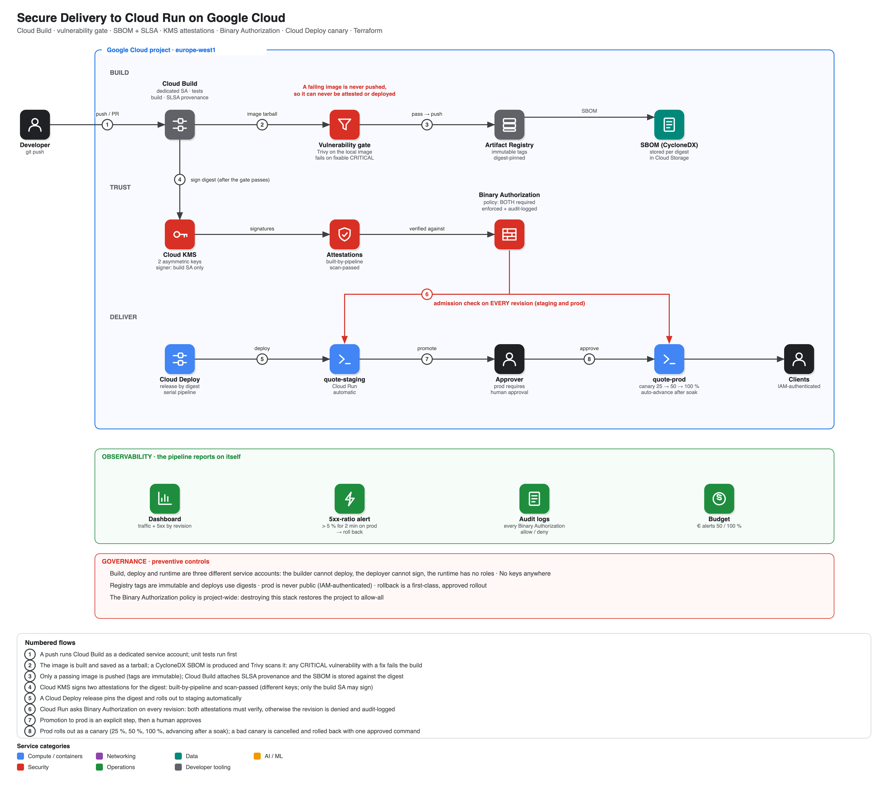

# Secure Delivery to Cloud Run on Google Cloud

A software supply chain you can point to and prove: nothing reaches production unless it was **built by this pipeline** and **passed a vulnerability gate** — two independently signed attestations, verified by **Binary Authorization** on every revision. Releases travel through Cloud Deploy by **immutable digest**, staging is automatic, prod needs a **human approval**, and a bad release is caught by a **25 % canary** and rolled back with one command. Provisioned and destroyed by **one script each**.

> **Status: deployed and verified live** (europe-west1, 2026-09-27). `./scripts/up.sh` builds the pipeline, ships a real release through staging → approval → canary → 100 % prod, and [`scripts/test.sh`](scripts/test.sh) checks the running system end to end. The first live run found a real permission gap — the canary's auto-advance automation couldn't advance itself — fixed and documented in [ADR 0003](docs/adr/0003-digest-pinned-canary.md) and [runbook 07](docs/runbooks/07-troubleshooting.md). The bad-release drill ([runbook 05](docs/runbooks/05-release-and-rollback.md)) ran for real: a faulty release was caught at canary-25 and rolled back.

```bash
gcloud config set project <your-project>      # billing linked; the rest is auto-detected
./scripts/up.sh       # infra -> secure build -> staging -> approve -> prod canary -> live tests
./scripts/down.sh     # delete everything (--purge also drops the state)
```

## What it proves

| Concern | Mechanism | Proven by |
|---|---|---|
| **Only trusted code runs** | Binary Authorization requires TWO attestations (`built-by-pipeline`, `scan-passed`), signed with KMS keys only the build SA may use | test §4: three kinds of rogue image, each denied and named |
| **Vulnerable images never ship** | Trivy gate on the local image, before push; CRITICAL + fixable = build fails | test §2 |
| **Tamper-evident** | SBOM (CycloneDX) and SLSA build provenance stored per exact digest | test §3 |
| **Reproducible releases** | Deploy by digest; immutable tags | test §4 |
| **Blast-radius limits** | Prod requires human approval; canary 25 % → 50 % → 100 %, advancing after a soak | test §5 |
| **Bad releases are caught and reversible** | 5xx-ratio alert; rollback is a normal, approved rollout | test §6 (the drill) |
| **Least privilege** | Three separate identities (build / deploy / runtime); no SA keys | test §7 |

## Architecture

[](docs/img/architecture.svg)

<sub>Click for the vector version. Diagram source: [`docs/diagrams/architecture.py`](docs/diagrams/architecture.py).</sub>

More: [architecture](docs/architecture.md) · [threat model](docs/threat-model.md)

## Design decisions

| ADR | Decision |
|---|---|
| [0001](docs/adr/0001-two-attestors.md) | Two independent attestors, not one |
| [0002](docs/adr/0002-gate-before-push.md) | The vulnerability gate runs before the image is ever pushed |
| [0003](docs/adr/0003-digest-pinned-canary.md) | Digest-pinned releases; Cloud Deploy owns the canary |
| [0004](docs/adr/0004-immutable-tags-and-rollback.md) | Immutable tags; rollback is a normal, approved rollout |

## Runbooks

[docs/runbooks](docs/runbooks/README.md): build & teardown · ship a change · inspect the evidence · admission denials · release & rollback (the drill) · cost · troubleshooting (7 real problems hit while building this).

## Repository layout

```
terraform/      identities · supplychain (KMS + attestors + policy) · delivery (Cloud Deploy) · monitoring
app/            quote service (Flask) + unit tests
cloudbuild.yaml the secure pipeline: test -> build -> SBOM -> vulnerability gate -> push -> attest
run/            Cloud Run service manifest template (rendered per environment by release.sh)
scripts/        up.sh · down.sh · build.sh · release.sh · test.sh · demo-bad-release.sh · capture-evidence.sh
```

## Cost & safety

Well under €1 for a full build-test-drill-teardown cycle; Cloud Run scales to zero; a budget with alerts is created by Terraform. **Binary Authorization is a project-wide, single policy** — `down.sh` reverts the project to allow-all, not just this repo's rules.

## Known gaps (deliberate)

No source-code provenance (branch protection, signed commits) · no automated smoke tests before promotion (approval is manual judgement) · vulnerability gate blocks CRITICAL-with-a-fix only · single region · the demo service is a toy.

## License

MIT
