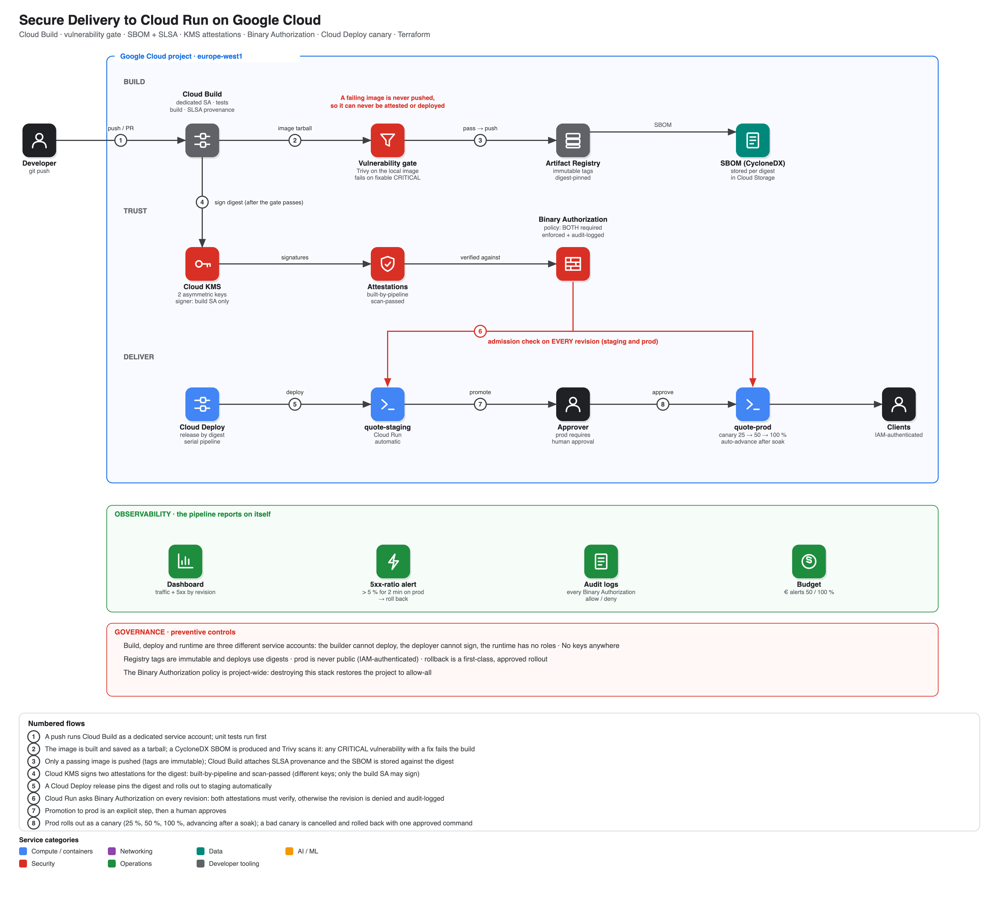

# Architecture



## The chain of custody

```
git push → Cloud Build (test → build → SBOM → gate → push) → Cloud KMS (2 attestations)
        → Binary Authorization (both required) → Cloud Deploy (staging → approval → canary → 100%)
```

Every step operates on the same **digest**: the gate scans the exact tarball that was pushed; the attestations sign that exact digest; Binary Authorization checks that exact digest on every Cloud Run revision; Cloud Deploy releases pin that exact digest. Nothing is re-resolved by tag after the build.

## Identities

| Service account | Can | Cannot |
|---|---|---|
| `csd-build` | push to `apps`, sign with both KMS keys, write SBOMs | deploy anything, act as another SA |
| `csd-deploy` | render/deploy via Cloud Deploy, advance canary rollouts (`clouddeploy.releaser`) | sign attestations, read source |
| `csd-app` | nothing (runtime identity of the deployed service) | — |

## What "admitted" requires
A Cloud Run revision is admitted only if **both** attestors verify against its digest:
- `built-by-pipeline` — signed immediately after a successful push
- `scan-passed` — signed only if the vulnerability gate exited 0

Missing either → denied, with the specific attestor named in the error and the attempt written to Cloud Audit Logs.

## Canary mechanics
First deployment to a target has no previous revision to split against, so Cloud Deploy **skips** the canary phases and parks at `stable`, waiting for a manual advance (`scripts/lib.sh`'s `finish_prod` handles this). Every subsequent release canaries for real: 25 % → (60 s soak, auto-advance) → 50 % → (60 s soak) → 100 %.
